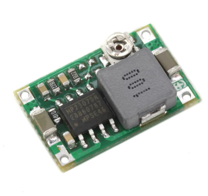
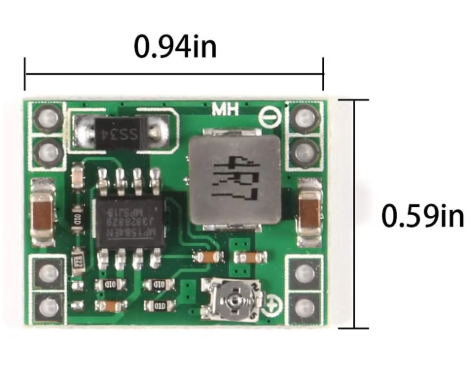
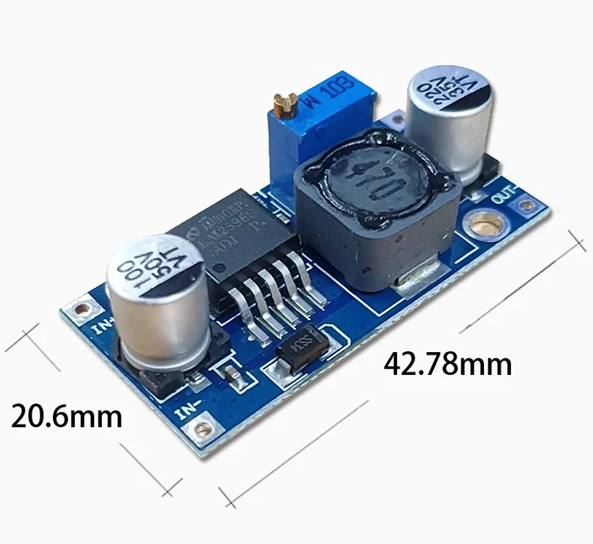
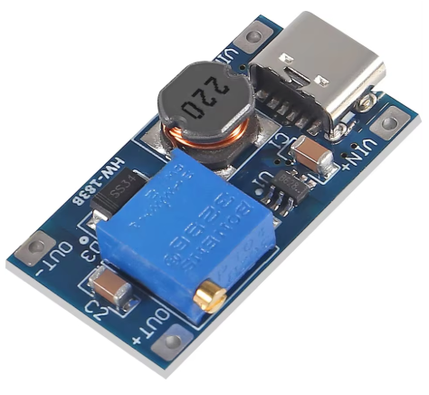
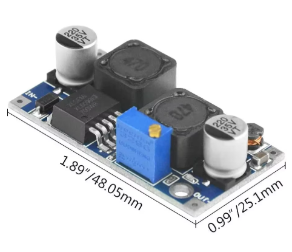
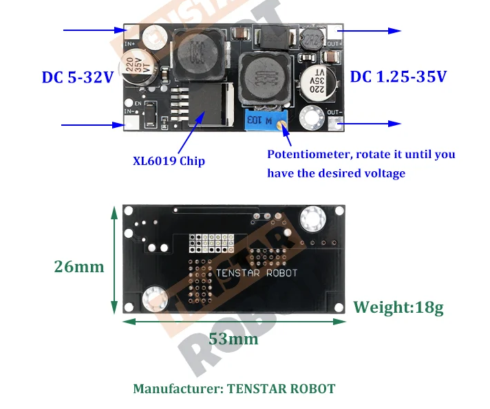
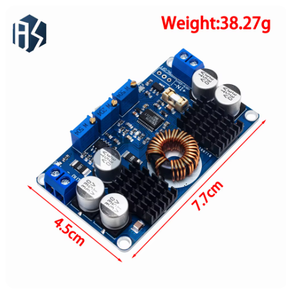

# 전압 변환 솔루션 (Voltage Converters Comparison)

다양한 DC-DC 컨버터 모듈의 스펙과 특징을 비교하는 문서입니다.

## 📊 스펙 비교표

| 제품명 | 유형 | 입력 전압 (Input) | 출력 전압 (Output) | 최대 전류 | 효율 (Max) | 단가 (약) | 특징 & 비고 |
| :--- | :---: | :--- | :--- | :---: | :---: | :---: | :--- |
| **Mini-360** | Buck (감압) | DC 4.75V ~ 23V | DC 1.0V ~ 17V | 3A (Peak) 1.8A (Cont) | 96% | **350원** | 초소형(17x11mm), 동기식 정류 장시간 사용시 1.8A 제한 |
| **MP1584EN** | Buck (감압) | DC 4.5V ~ 28V | DC 0.8V ~ 20V | 3A | 92% | **583원** | 초소형(22x17mm), 고주파(1.5MHz) 저전압 리플, 역극성/무부하 주의 |
| **LM2596** | Buck (감압) | DC 3.2V ~ 35V | DC 1.25V ~ 30V | 3A | 92% | **680~1,030원** | 입력전압이 출력보다 1.5V 높아야 함 단락/과열 보호, 전원 LED 장착 |
| **MT3608** | Boost (승압) | DC 2V ~ 24V | DC 5V ~ 28V | 2A (Peak) | 93% | **450원** | Micro USB / **Type-C** 입력 가능 초기 세팅 주의 (반시계 20바퀴) |
| **XL6009** | **Buck-Boost** (자동 승강압) | DC 3.8V ~ 32V | DC 1.25V ~ 35V | 3A (Max 4A) | <94% | **800~1,130원** | 입력 전압이 출력보다 높거나 낮아도 OK 태양광/차량용 전압 안정화 최적 |
| **XL6019** | **Buck-Boost** (자동 승강압) | DC 5V ~ 32V | DC 1.3V ~ 35V | 1.5A (Cont) Max 4A | 94% | **1,250원** | XL6009의 개량형 (발열/노이즈 개선) 내장 MOSFET 성능 향상 |
| **LTC3780** | **Buck-Boost** (자동 승강압) | DC 5V ~ 32V | DC 1V ~ 30V | 8A (Cont) Max 10A | - | **12,000원** | **끝판왕** (고출력 80W~130W) 단락 보호 O, 역극성 보호 X |

---

## 🖼️ 제품 이미지 및 상세

### 1. Mini-360 (Ultra-small DC-DC Buck)

*   **입력 전압**: 4.75V ~ 23V
*   **출력 전압**: 1.0V ~ 17V
*   **출력 전류**:
    *   Peak: 3A
    *   Continuous (장시간): 1.8A
*   **변환 효율**: 최대 96% (가장 높음) - 동기식 정류(Synchronous Rectification) 방식 사용.
*   **스위칭 주파수**: 340KHz
*   **크기**: 17mm x 11mm x 3.8mm (가장 작음)
*   **특징**: 일체형 파워 인덕터 사용, 모바일 배터리/통신 장비 등 공간 제약이 심한 곳에 최적.

### 2. MP1584EN (Mini DC-DC Step-Down)

*   **입력 전압**: 4.5V ~ 28V (최대)
*   **출력 전압**: 0.8V ~ 20V (가변)
*   **스위칭 주파수**: 1.5MHz (일반 1MHz) - 고주파 동작으로 리플이 적음.
*   **출력 리플**: < 30mV
*   **크기**: 22mm x 17mm x 4mm (초소형)
*   **주의사항**:
    *   **역극성 금지**: (+)와 (-)를 반대로 연결하면 즉시 파손됨.
    *   **무부하 금지**: 부하가 없거나 너무 가벼운(10% 미만) 상태로 켜지 마세요.

### 3. LM2596 (DC-DC Step-Down)

*   **입력 전압**: 3.2V ~ 35V (부스트 기능 없음, 입력 > 출력 + 1.5V 필수)
*   **출력 전압**: 1.25V ~ 30V (가변 저항으로 조정)
*   **출력 효율**: 
    *   12V 출력 시: 약 90.85%
    *   5V 출력 시: 약 84.25%
*   **주요 특징**:
    *   두꺼운 회로 기판 사용으로 내구성이 좋음.
    *   단락(Short) 및 과열(Overheat) 보호 기능 내장.
    *   입력 전압 상태를 알 수 있는 빨간색 전원 LED 장착.

### 4. MT3608 (2A DC-DC Step-Up Boost)

*   **유형**: 승압 (Boost) - 입력보다 높은 전압을 만들 때 사용.
*   **가격**: 약 **450원** (10개 4500원 기준)
*   **입력 전압**: 2V ~ 24V (최대 입력 초과 금지)
*   **출력 전압**: 5V ~ 28V (무조건 입력 < 출력이어야 함)
*   **출력 전류**: 최대 2A (Peak)
*   **효율**: > 93%
*   **특징**:
    *   **USB 입력**: **Micro USB** 또는 **Type-C** 포트가 달려 있어 충전기 연결이 매우 쉽음.
    *   **초기 설정 주의**: 처음 받았을 때 전압 조절이 안 되면, 가변 저항(전위차계)을 **반시계 방향으로 20바퀴 이상** 돌려야 작동 시작함.
    *   **조정 방법**: 가슴 앞쪽(정면)에서 볼 때 반시계 방향으로 돌려야 전압이 올라감(Boost).

### 5. XL6009 (4A Auto Buck-Boost Module)

*   **유형**: **자동 승강압 (Buck-Boost/SEPIC)**
    *   입력 전압이 출력 전압보다 **높아도(Buck)**, **낮아도(Boost)** 설정한 출력 전압을 일정하게 유지함.
*   **가격**: 약 **800원 ~ 1,130원** (3개 2,400~3,400원 기준)
*   **입력 전압**: 3.8V ~ 32V
*   **출력 전압**: 1.25V ~ 35V (가변)
*   **출력 전류**: 3A (최대 4A, 방열판 권장)
*   **효율**: < 94% (전압 차이가 클수록 효율 저하)
*   **스위칭 주파수**: 400KHz 
*   **크기**: 48mm x 25mm x 14mm
*   **특징**:
    *   **전천후 전압 안정기**: 태양광 패널(전압 등락 심함)이나 자동차 배터리(시동 시 전압 강하) 등에 연결해도 항상 일정한 12V/24V를 뽑아낼 수 있음.
    *   **주의**: 일반적인 저가형 XL6009 모듈 중에는 '승압 전용(Boost)'인 경우도 있으므로, 구매 시 **"1.25V~35V 출력"** 문구를 꼭 확인해야 함. (승압 전용은 입력보다 낮은 전압 출력 불가)

### 6. XL6019 (Automatic Step-up & Step-down)

*   **유형**: **자동 승강압 (Auto Buck-Boost)**
*   **가격**: 약 **1,250원** (3개 3,750원 기준)
*   **입력 전압**: 5V ~ 32V
*   **출력 전압**: 1.3V ~ 35V (연속 가변)
*   **출력 전류**: 
    *   연속 사용: 1.5A (Max)
    *   입력 전류 제한: 4A (Max)
*   **출력 전력**: 자연 냉각 20W (방열판 추가 시 25W)
*   **효율**: 94%
*   **특징**:
    *   **XL6009의 업그레이드 버전**: 더 좋은 인덕터와 커패시터를 사용하여 발열과 노이즈를 줄임.
    *   **차이점**: XL6009보다 스펙상 전류량은 조금 낮게 표기되지만(1.5A), 실제 안정성은 더 높음.

### 7. LTC3780 (High Power Auto Buck-Boost)

*   **유형**: **고출력 자동 승강압 (High Power Buck-Boost)**
*   **가격**: 약 **12,000원**
*   **입력 전압**: DC 5V ~ 32V (권장 10V 이상)
*   **출력 전압**: DC 1V ~ 30V
*   **출력 전류**: 
    *   장시간: 7A ~ 8A
    *   최대(Peak): 10A
*   **출력 전력**: 
    *   지속: 80W
    *   피크: 130W (80W 이상 시 강제 냉각 필수)
*   **보호 기능**:
    *   **단락 보호(Short Circuit Protection)**: **있음** (매우 중요)
    *   **입력 역극성 보호**: **없음** (반대로 꽂으면 터짐 -> 퓨즈/다이오드 필수)
    *   **출력 역류 방지**: **없음** (배터리 충전 시 쇼트키 다이오드 필수)
*   **크기**: 77.6mm x 46.5mm x 15mm (중량 45g)
*   **특징**:
    *   **정전압(CV) & 정전류(CC)** 제어 가능 (고급형).
    *   언더볼티지 락아웃(저전압 차단) 기능 등으로 배터리 방전 보호 가능.
