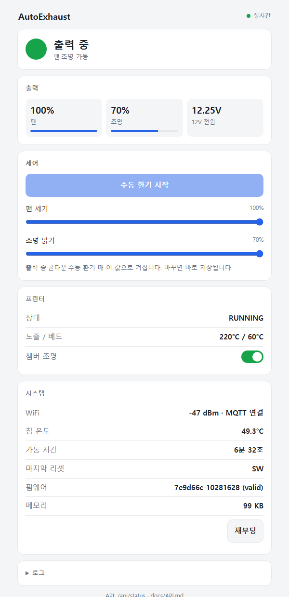

# AutoExhaust

Bambu Lab 3D 프린터의 출력 상태를 따라 **배기팬과 조명을 자동으로 켜고 끄는** ESP32-C3 컨트롤러입니다.
프린터의 LAN MQTT로 상태를 받아서, 출력이 시작되면 환기를 시작하고, 끝나면 몇 분 더 돌린 뒤 멈춥니다.

<p align="center"></p>

## 주요 기능
- **출력 연동 자동 제어**: 출력 시작(`PREPARE`, `RUNNING`, `PAUSE`)과 함께 팬과 조명을 켜고, 출력이 끝나면 팬은 5분, 조명은 1분 더 켜 둡니다(쿨다운).
- **프린터 챔버 조명 연동**: 출력 시작 시 MQTT로 프린터 내부 조명을 켜고, 출력 종료 후 끕니다.
- **통신 끊김 대비**: 출력 중에 WiFi나 MQTT가 끊기면 최대 30분 동안 환기를 유지하고, 연결이 돌아오면 상태를 다시 맞춥니다.
- **웹 대시보드와 REST API**: 상태를 실시간으로 보여 주고, 팬·조명 세기와 수동 환기를 제어합니다. API 문서([docs/API.md](docs/API.md))를 AI 에이전트에게 주면 그대로 제어에 쓸 수 있습니다.
- **전원 예산 보호**: 1.5A 어댑터에 맞춰 조명 상한을 70%로 고정하고, 소프트 스타트와 팬 킥스타트를 적용합니다.
- **안전 장치**
  - 저전압, 칩 과열, 크래시 반복이 감지되면 부하를 끄고 원인을 기록한 뒤 잠듭니다(FAULT). 잠든 동안 RGB LED가 원인별 색으로 켜져 있습니다.
  - 펌웨어가 멈추면 watchdog이 재부팅하고, 크래시 위치를 기록합니다.
  - OTA로 올린 펌웨어가 비정상이면 이전 버전으로 자동 롤백합니다.

## 하드웨어
| 부품 | 비고 |
|---|---|
| ESP32-C3 SuperMini | 컨트롤러 |
| 로우사이드 MOSFET 모듈 ×2 | 배기팬, LED 스트립 |
| 12V 1.5A 어댑터 + 강압 컨버터 (3.6V) | ESP32 전원 |
| 120mm 2핀 팬, 12V LED 스트립 ×2 | 부하 |
| RGB LED (공통 캐소드), 택트 버튼, 분압 저항 100kΩ/20kΩ | 상태 표시, 수동 조작, 전압 측정 |

핀 배치, 전원 경로, 보호 부품은 [hardware/circuit.md](hardware/circuit.md)에 있습니다.

## 동작 방식
```
BOOT → IDLE ⇄ RUNNING → COOLDOWN → IDLE
         ↕ MANUAL (수동 환기)   ↕ OFFLINE (통신 끊김)
모든 상태 → FAULT (deep sleep, 전원 재투입으로 복구)
```
각 상태로 넘어가는 조건은 [docs/AutoExhaust_Flow.md](docs/AutoExhaust_Flow.md)에 정리되어 있습니다.

### 표시
| 장치 RGB LED | 의미 |
|---|---|
| 꺼짐 | 대기 (IDLE) |
| 무지개 | 출력 중 |
| 파랑 숨쉬기 | 쿨다운 |
| 보라 | 수동 환기 |
| 주황 깜빡임 | 프린터 연결 끊김 |
| 빨강 / 노랑 / 흰색 고정 + 내장 LED 꺼짐 | FAULT: 칩 과열 / 저전압 / 크래시 반복 |

내장 LED는 WiFi 상태를 나타냅니다. 켜짐은 WiFi와 MQTT 모두 연결, 1Hz 깜빡임은 WiFi만 연결, 4Hz 깜빡임은 WiFi 끊김입니다.

**버튼**: 짧게 누르면 전원 상태(초록, 노랑, 빨강)를 5초간 보여 줍니다. 2초 이상 눌렀다 떼면 수동 환기를 켜거나 끕니다.

## 설치

### 준비
- [arduino-cli](https://arduino.github.io/arduino-cli/) 또는 Arduino IDE
- ESP32 보드 패키지 **3.3.x** (`esp32:esp32`)
- 라이브러리: `PubSubClient` 2.8, `ArduinoJson` 7.x
- 프린터: LAN 모드에서 **액세스 코드**와 **시리얼 번호** 확인

```bash
arduino-cli core install esp32:esp32
arduino-cli lib install PubSubClient ArduinoJson
```

### 설정
1. `firmware/AutoExhaust/secrets.example.h`를 같은 폴더에 `secrets.h`로 복사하고, WiFi, 액세스 코드, 시리얼 번호, OTA 비밀번호를 채웁니다. `secrets.h`는 git에 올라가지 않습니다.
2. `firmware/AutoExhaust/Config.h`에서 `MQTT_SERVER`를 프린터 IP로 바꿉니다.
3. 필요하면 `Config.h`에서 쿨다운 시간, 조명 상한, 전압 임계값 등을 조정합니다.

### 첫 플래시 (USB)
파티션을 **Minimal SPIFFS (1.9MB APP with OTA)**로 지정해야 합니다. 기본 파티션에는 펌웨어가 들어가지 않습니다.

```bash
cd firmware/AutoExhaust
arduino-cli compile --upload -p <포트> \
  --fqbn esp32:esp32:makergo_c3_supermini:PartitionScheme=min_spiffs .
```

### 이후 업데이트 (OTA)
```bash
cd firmware/AutoExhaust
./ota.sh <장치 IP>
```
스크립트는 컴파일, 업로드, 검증을 차례로 수행합니다.
- 새 펌웨어가 60초 동안 정상(WiFi와 웹/OTA 동작)이면 `valid`로 확정합니다.
- 그렇지 않으면 부트로더가 이전 펌웨어로 롤백합니다.

## 사용
- **웹 대시보드**: `http://autoexhaust.local` 또는 장치 IP. 같은 네트워크에서만 접속할 수 있습니다. 안드로이드 브라우저에서는 `.local` 주소가 안 될 수 있으니 IP를 쓰세요.
- **REST API**: [docs/API.md](docs/API.md)
  ```bash
  curl http://autoexhaust.local/api/status
  curl -X POST http://autoexhaust.local/api/settings -H 'Content-Type: application/json' -d '{"light_pct": 60}'
  ```

## 디렉터리
```
firmware/AutoExhaust/   펌웨어 (Arduino 스케치), ota.sh
hardware/               회로, 부품 비교, 핀맵
hardware-tests/         하드웨어·WiFi 시험용 스케치 (WiFi_Stability 등)
docs/                   상태 설계(Flow), API, TODO, 개발 노트
samples/mqtt/           프린터 MQTT 리포트 예시
```

## 한계와 계획
- Bambu Lab X1C에서만 시험했습니다. 다른 기종은 MQTT 리포트 형식이 다를 수 있습니다.
- 펌웨어 2025년 이후의 Authorization Control 설정에 따라 챔버 조명 제어가 거부될 수 있습니다. 이 경우 `Config.h`에서 `CHAMBER_LIGHT_SYNC = false`로 끄면 됩니다.
- 계획: SmartThings 연동 ([docs/TODO.md](docs/TODO.md))

## 라이선스
[MIT](LICENSE)
