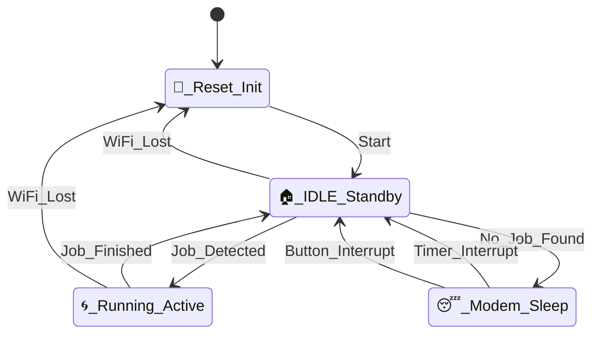

# 🌀 AutoExhaust 2.0 시스템 상태 설계서

## 1. 개요 및 하드웨어 사양
- **Modem Sleep**: MQTT 메시지 수신을 위해 WiFi 연결을 유지하며 10초 주기로 인터럽트 확인.
- **RGB 인터럽트**: 어느 상태에서든 버튼이 눌리면 **5초간 전원 상태** 표시 후 기존 상태로 복귀.

## 2. 시스템 상태 다이어그램 (State Machine)

## 3. 세부 상태 정의 (Detailed State)

### 🚀 Reset_Init 상태
- **시스템 초기화**: GPIO 설정, ADC 보정, 무선 통신(WiFi) 및 MQTT 초기화를 수행합니다.
- **웹 서버 구동**: 리셋 직후 웹페이지 제어 로직을 생성하여 관리자 접속을 준비합니다.
- **내장 LED**: 네트워크 연결 시도 시점부터 **1Hz 간격으로 점등**하여 초기화 중임을 알립니다.

### 🏠 IDLE_Standby 상태
- **감시**: MQTT 브로커로부터 `print_running` 메시지가 오는지 상시 모니터링합니다.
- **내장 LED**: WiFi 및 MQTT 연결이 완료되면 **상시 점등(ON)**으로 전환됩니다.
- **전환**: 
    - `print_running` 수신 시 → **Running_Active**로 전환.
    - 일정 시간(체크 후 즉시) 작업이 없으면 → **Modem_Sleep**으로 전환.

### 🌀 Running_Active 상태
- **출력 가동**: 팬(Fan)과 LED 스트립을 미리 설정된 밝기/속도로 활성함니다.
- **시각 효과**: RGB LED가 무지개(Rainbow) 루프로 점등되어 가동 중임을 알립니다.
- **내장 LED**: **상시 점등(ON)** 상태를 유지합니다.
- **전환**: `print_finish` 또는 에러 메시지 수신 시 → **IDLE_Standby**로 복귀.

### 😴 Modem_Sleep 상태
- **동작**: 시스템 부하가 없을 때 전력 소모를 줄이기 위해 WiFi 라디오를 끄지 않고 CPU만 가볍게 재우는 Modem Sleep에 진입합니다.
- **내장 LED**: 수면 중에는 **소등(OFF)** 됩니다.
- **웨이크업(Wakeup)**: 
    1. **10 Second Timer Interrupt**: 10초마다 자동으로 깨어나 메시지를 확인합니다.
    2. **Button Interrupt**: 물리 버튼 클릭 시 즉시 깨어나 IDLE 상태로 복원됩니다.

## 4. 세부 동작 정의 (Detailed Logic)

### 💡 내장 LED 상태 매핑
- **OFF**: 😴_Sleep 상태 혹은 전원 OFF
- **1Hz Blink**: 📡_Networking (연결 중)
- **ON**: 🏠_IDLE 또는 🌀_Running (연결 완료)

### 🌈 RGB_Power_Display (Global)
- **트리거**: 상태와 관계없이 버튼 클릭 시 발생.
- **동작**: 전압(ADC) 데이터를 기반으로 특정 색상 점등.
- **복귀**: **5초 경과 후** 버튼을 누르기 전의 원래 상태와 동작(예: 무지개 루프 등)으로 자동 복구.

### 🔋 Modem Sleep 전략
- 고전력 Deep Sleep 대신 **Modem Sleep(Light Sleep)**을 채택하여 WiFi 연결을 유지합니다.
- 10초 주기로 깨어나 MQTT 브로커로부터 메시지를 확인하며, 불필요한 재연결 전력 소모를 방지합니다.

### 🌐 웹 제어 인터페이스
- 리셋 직후 웹페이지 제어 로직을 초기화하여 사용자 접속 준비를 마칩니다.
- 실시간 팬 속도 조절 및 LED 스트립 밝기 설정을 지원합니다.

### 🛡️ 예외 처리 (Fail-safe)
- **WiFi 유실**: `Sleep` 상태를 제외한 모든 상태에서 네트워크 연결이 끊어지면 안전을 위해 `State_Reset`으로 돌아가 재연결 및 초기화 프로세스를 수행합니다.
- **인터럽트 방어**: 버튼 입력에 의한 전원 상태 표시 로직은 주 프로세스의 흐름을 방해하지 않도록 설계되었습니다.

---
**최종 수정일**: 2026-03-01