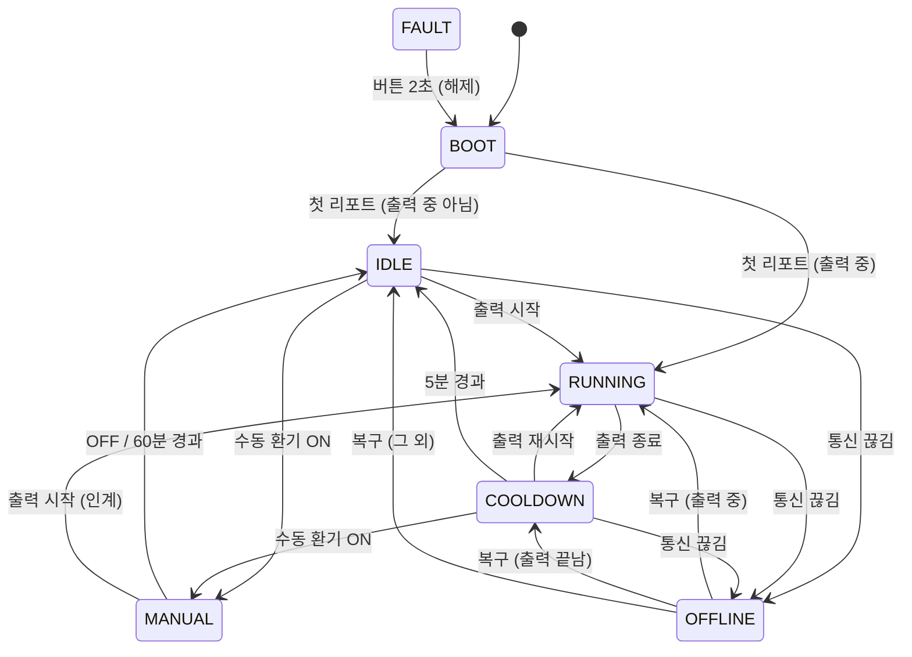

# 🌀 AutoExhaust 2.0 시스템 상태 설계서

## 1. 개요
- 프린터(Bambu X1C)의 MQTT 상태를 받아서 배기팬과 LED 스트립을 자동으로 켜고 끕니다.
- **슬립은 사용하지 않습니다.** WiFi 라디오가 항상 켜져 있고(`WiFi.setSleep(false)`), TX 출력은 8.5dBm입니다. 근거는 `Hardware_Test/WiFi_Stability`에서 측정한 결과입니다.
- 웹 대시보드(`/`)와 REST API(`/api/*`, [API.md](API.md))로 제어할 수 있습니다.
- 모든 수치(시간, 임계값, 상한)는 `Config.h` 한 곳에 모여 있습니다.

## 2. 상태 다이어그램

`FAULT`로는 어느 상태에서든 들어갈 수 있습니다(저전압, 칩 과열).

## 3. 상태별 동작

| 상태 | 팬 | 조명 | RGB | 비고 |
|---|---|---|---|---|
| BOOT | OFF | OFF | 전원 상태 색 | 첫 프린터 리포트를 기다리는 중 |
| IDLE | OFF | OFF | 꺼짐 | |
| RUNNING | ON | ON | 무지개 | `PREPARE`, `RUNNING`, `PAUSE`일 때. 진입하면 프린터 챔버 조명 ON |
| COOLDOWN | 5분 | 1분 | 파란 Breathing | 조명이 꺼질 때 챔버 조명도 OFF |
| MANUAL | ON | ON | 보라 | 60분 뒤 자동 해제. 출력이 시작되면 RUNNING으로 넘어감 |
| OFFLINE | 유지 | 유지 | 주황 깜빡임 | 출력 중에 끊겼으면 최대 30분 유지, 쿨다운 중이었으면 쿨다운을 이어감 |
| FAULT | OFF | OFF | 빨강 빠른 깜빡임 | 래치 상태. 버튼으로만 해제 |

- ON일 때의 세기는 웹이나 API에서 정한 **설정값**을 씁니다. 기본값은 팬 100%, 조명 70%이고, NVS에 저장되어 재부팅 후에도 유지됩니다.
- **통신 끊김**의 기준은 WiFi 끊김, MQTT 끊김, 또는 60초 동안 리포트가 오지 않는 경우입니다.

## 4. 세부 동작

### 💡 내장 LED (WiFi 상태 전용)
- **ON**: WiFi와 MQTT 모두 연결됨
- **1Hz 깜빡임**: WiFi만 연결됨
- **4Hz 깜빡임**: WiFi 끊김

### 🔘 버튼 (GPIO9: 부팅 스트랩 핀)
모든 동작은 **버튼을 뗄 때** 실행됩니다. 부팅할 때 이미 눌려 있던 입력은 한 번 뗄 때까지 무시합니다. 재부팅은 기계식 스위치나 `POST /api/reboot`으로 합니다.

| 누른 시간 | 누르는 중 RGB | 뗐을 때 동작 |
|---|---|---|
| 2초 미만 | 변화 없음 | 전원 상태 색을 5초간 표시 |
| 2초 이상 | 청록 | 수동 환기 ON/OFF (FAULT 상태에서는 FAULT 해제) |

### 🔄 펌웨어 업데이트 (OTA 전용)
- `esp32/AutoExhaust/ota.sh` 순서: 컴파일 → OTA 업로드 → `/api/status`로 검증 확인
- 새 펌웨어는 `pending_verify` 상태로 부팅합니다. 아래 두 조건을 모두 만족하면 `valid`로 확정됩니다.
  - WiFi와 웹/OTA가 정상
  - 그 상태로 60초가 지남
- 크래시가 나거나, 3분 안에 정상 상태가 되지 못하면 부트로더가 **이전 펌웨어로 자동 롤백**합니다.
  - `./ota.sh --selftest-fail`로 롤백 동작을 시험할 수 있습니다(2026-10-28에 확인).
- 막지 못하는 경우: 검증을 통과한 뒤에 루프를 오래 막는 코드. `loop()` 안에서 오래 기다리는 코드(`delay`, 대기 루프)는 금지입니다.
- 최후의 수단: USB로 연결하고 부팅 중 버튼을 누른 상태로 플래싱합니다.

### 🔋 전원 보호 (12V 1.5A)
- 조명 상한은 70%(`MAX_LIGHT_DUTY`)이며 웹이나 API로도 넘을 수 없습니다.
- 조명은 1초에 걸친 소프트 램프로 켜고 끕니다.
- 팬은 25kHz PWM입니다. duty가 100% 미만이면 처음 1초는 100%로 돌려 기동시키고(킥스타트), 최소 duty는 30%입니다.
- 전압은 감시만 하고 그 값으로 출력을 조절하지는 않습니다(피드백 제어 없음). 부하가 켜진 상태에서 10.5V 미만이 2초 넘게 이어지면 **FAULT 래치**가 걸립니다. 5V 미만은 12V가 꺼진 상태(USB 전원만 연결)로 보고 FAULT로 처리하지 않습니다.
- RGB 전원 색 기준은 11.6V 초과면 초록, 11.0V 초과면 노랑, 그 이하면 빨강입니다. **부하를 건 상태에서 실측한 뒤 다시 정해야 합니다.**

### 📡 WiFi 감시
- 끊긴 이유(reason 코드)를 로그에 남깁니다.
- 30초 넘게 끊겨 있으면 `disconnect()` 후 `begin()`으로 수동 재접속합니다.
- 5분 넘게 끊겨 있으면 재부팅합니다.

---
**최종 수정일**: 2026-10-28
