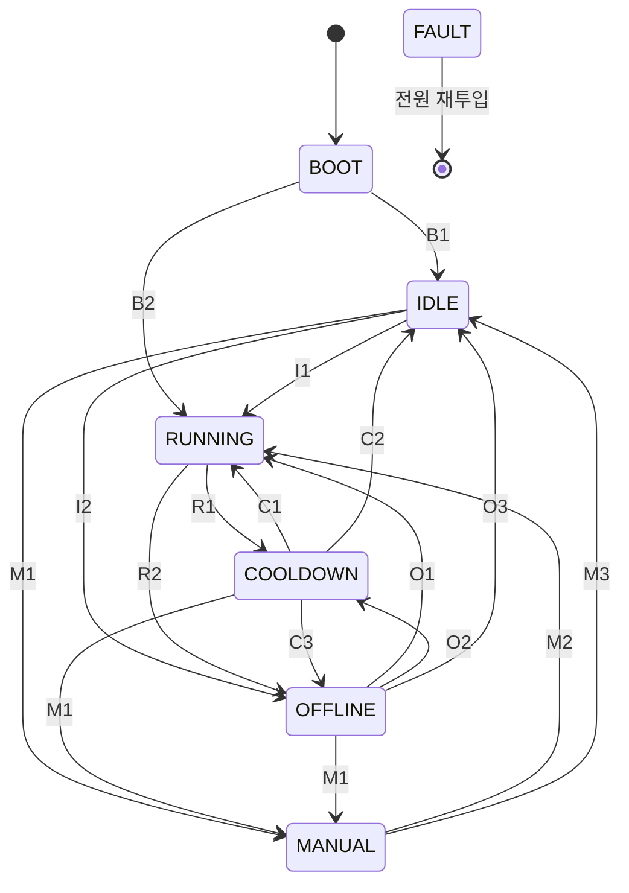

# 🌀 AutoExhaust 2.0 시스템 상태 설계서

## 1. 개요
- 프린터(Bambu X1C)의 MQTT 상태를 받아서 배기팬과 LED 스트립을 자동으로 켜고 끕니다.
- **동작 중에는 슬립을 사용하지 않습니다.** WiFi 라디오는 항상 켜져 있고(`WiFi.setSleep(false)`), TX 출력은 11dBm입니다.
  - 근거는 `hardware-tests/WiFi_Stability`의 측정 결과와 설치 위치의 RSSI입니다.
  - 예외는 FAULT 하나입니다. FAULT가 나면 deep sleep으로 들어가고 다시 깨어나지 않습니다.
- 웹 대시보드(`/`)와 REST API(`/api/*`, [API.md](API.md))로 제어합니다.
- 모든 수치(시간, 임계값, 상한)는 `Config.h` 한 곳에 모여 있습니다.

## 2. 상태 다이어그램


FAULT로는 **모든 상태에서** 들어갈 수 있습니다(F1~F3). FAULT에 들어가면 deep sleep 상태가 되고, 기계 스위치로 전원을 다시 켜야만 BOOT부터 다시 시작합니다.

## 3. 판정에 쓰는 신호
| 신호 | 정의 |
|---|---|
| **online** | MQTT가 연결돼 있고, 마지막 프린터 리포트를 받은 지 60초가 지나지 않음 |
| **printing** | online이면서 `gcode_state`가 `PREPARE`, `RUNNING`, `PAUSE` 중 하나 |
| **수동 ON/OFF 요청** | 웹 버튼, `POST /api/manual`, 또는 장치 버튼을 2초 이상 누르고 뗌 (토글) |

## 4. 상태 전이 조건

### BOOT: 첫 프린터 리포트를 기다림
| ID | 다음 상태 | 조건 |
|---|---|---|
| B1 | IDLE | online이 되었고 printing이 아님 |
| B2 | RUNNING | online이 되었고 printing |

online이 되지 않으면 BOOT에 계속 머뭅니다. 부하는 OFF입니다.

### IDLE: 대기
| ID | 다음 상태 | 조건 |
|---|---|---|
| I1 | RUNNING | printing |
| I2 | OFFLINE | online이 아니게 됨 |
| M1 | MANUAL | 수동 ON 요청 |

### RUNNING: 출력 중
| ID | 다음 상태 | 조건 |
|---|---|---|
| R1 | COOLDOWN | online인데 printing이 아니게 됨 (출력 종료, 실패, 취소) |
| R2 | OFFLINE | online이 아니게 됨 |

- 수동 ON 요청은 무시하고 로그만 남깁니다(이미 가동 중이므로).
- RUNNING에 들어갈 때 프린터 챔버 조명을 ON합니다. 단, 이미 진행 중인 출력에 합류한 경우(출력 중 부팅 = B2, OFFLINE에서 복귀 = O1)에는 보내지 않습니다. 사용자가 프린터에서 직접 바꾼 조명 상태를 덮어쓰지 않기 위해서입니다. 출력이 끝날 때 보내는 OFF는 어느 경우든 보냅니다.

### COOLDOWN: 출력 후 연장 가동
| ID | 다음 상태 | 조건 |
|---|---|---|
| C1 | RUNNING | 다시 printing |
| C2 | IDLE | COOLDOWN에 들어간 지 5분 경과 (팬 연장 시간 종료) |
| C3 | OFFLINE | online이 아니게 됨 |
| M1 | MANUAL | 수동 ON 요청 |

조명은 들어간 지 1분 뒤 꺼지고, 그때 챔버 조명 OFF도 보냅니다.

### MANUAL: 수동 환기
| ID | 다음 상태 | 조건 |
|---|---|---|
| M2 | RUNNING | printing (출력이 시작되면 그쪽에 넘겨줌. 그 출력이 끝나면 RUNNING → COOLDOWN 순서를 따름) |
| M3 | IDLE | 수동 OFF 요청, 또는 들어간 지 60분 경과 |

프린터 연결과는 무관하게 동작하므로, online이 아니어도 OFFLINE으로 넘어가지 않습니다.

### OFFLINE: 프린터 상태를 알 수 없음
| ID | 다음 상태 | 조건 |
|---|---|---|
| O1 | RUNNING | 다시 online이 되었고 printing |
| O2 | COOLDOWN | 다시 online이 되었고 printing이 아님. 이 경우는 두 가지입니다. ① 끊기기 전이 RUNNING이었고 30분 유지 시간 안에 복구됨 → 쿨다운을 새로 시작. ② 끊기기 전이 COOLDOWN이었고 쿨다운 시간이 남아 있음 → 남은 쿨다운을 이어서 진행 |
| O3 | IDLE | 다시 online이 되었는데 O1, O2에 해당하지 않음 |
| M1 | MANUAL | 수동 ON 요청 |

OFFLINE 동안의 부하는 끊기기 직전 상태에 따라 다릅니다.
- 직전이 RUNNING: 팬과 조명을 **최대 30분** 유지한 뒤 OFF
- 직전이 COOLDOWN: 쿨다운 타이머를 그대로 진행
- 그 외: OFF

### FAULT: 종료 상태 (deep sleep)
| ID | 조건 | 측정 방법 | RGB (고정) |
|---|---|---|---|
| F1 | **저전압** | 팬이나 조명이 켜져 있고, 12V가 5V 초과 10.5V 미만인 상태가 2초 넘게 이어짐 | 🟡 노랑 |
| F2 | **칩 과열** | 칩 온도가 80°C 초과 (5초마다 측정) | 🔴 빨강 |
| F3 | **크래시 반복** | 크래시(panic 또는 watchdog)가 10분 안에 3회 발생 | ⚪ 흰색 |

- 저전압 판정은 부하가 켜져 있을 때만 합니다. 5V 미만은 12V가 꺼진 상태(USB 전원만 연결)로 보고 FAULT로 처리하지 않습니다.
- F3의 10분은 크래시 사이에 실제로 동작한 시간을 합한 값입니다. 정상 재부팅(OTA, API, 전원 재투입)을 하면 카운트가 0으로 돌아갑니다.

**FAULT에 들어가면**
1. 팬과 조명을 OFF합니다.
2. NVS(플래시)에 기록을 저장합니다: 원인, 측정값, 시각, 가동 시간, 펌웨어 버전, 직전 로그 20줄.
3. 핀 상태를 고정합니다: 부하 핀은 LOW, RGB는 원인별 색, 내장 LED는 OFF.
4. 깨어나는 조건 없이 deep sleep에 들어갑니다. 웹, API, OTA 모두 응답하지 않습니다.

**복구**는 기계 스위치로 전원을 껐다 켜는 것뿐입니다. 다시 켜면 웹 UI 맨 위에 "지난 FAULT" 카드가 나타나고, 확인 버튼을 누를 때까지 남아 있습니다.

**상황 구분**
| RGB | 내장 LED | 의미 |
|---|---|---|
| 단색 고정 (빨강, 노랑, 흰색) | 꺼짐 | FAULT (deep sleep) |
| 꺼짐 | 꺼짐 | 12V 차단 또는 장치 고장 |
| 애니메이션이나 상태 색 | 켜짐 또는 깜빡임 | 정상 동작 |

## 5. 상태별 출력과 표시
| 상태 | 팬 | 조명 | RGB |
|---|---|---|---|
| BOOT | OFF | OFF | 전원 상태 색 |
| IDLE | OFF | OFF | 꺼짐 |
| RUNNING | ON | ON | 무지개 |
| COOLDOWN | 5분 | 1분 | 파란 Breathing |
| MANUAL | ON | ON | 보라 |
| OFFLINE | 위 OFFLINE 설명 참고 | 위 OFFLINE 설명 참고 | 주황 깜빡임 |
| FAULT | OFF | OFF | 원인별 색 고정 |

- ON일 때의 세기는 **설정값**을 씁니다. 기본값은 팬 100%, 조명 70%이며 웹이나 API로 바꿀 수 있고 NVS에 저장됩니다.
- 출력 단계는 이렇게 동작합니다.
  - 조명 상한은 70%이고 웹이나 API로도 넘을 수 없습니다.
  - 조명은 1초에 걸친 소프트 램프로 켜고 끕니다.
  - 팬은 25kHz PWM입니다. duty가 100% 미만이면 처음 1초는 100%로 돌려 기동시키고(킥스타트), 최소 duty는 30%입니다.

### 💡 내장 LED (WiFi 상태 전용)
- **ON**: WiFi와 MQTT 모두 연결됨
- **1Hz 깜빡임**: WiFi만 연결됨
- **4Hz 깜빡임**: WiFi 끊김

### 🔘 버튼 (GPIO9: 부팅 스트랩 핀)
동작은 버튼을 **뗄 때** 실행됩니다. 부팅할 때 이미 눌려 있던 입력은 한 번 뗄 때까지 무시합니다.

| 누른 시간 | 누르는 중 RGB | 뗐을 때 동작 |
|---|---|---|
| 2초 미만 | 변화 없음 | 전원 상태 색을 5초간 표시 |
| 2초 이상 | 청록 | 수동 환기 토글 |

## 6. 런타임 안전장치
| 상황 | 동작 |
|---|---|
| 예외 발생 (잘못된 메모리 접근 등) | panic → 크래시 정보(coredump)를 플래시에 저장 → 즉시 재부팅 → 약 7초 뒤 원래 동작으로 복귀. 웹 UI에 "지난 크래시"(태스크, PC, RA) 표시 |
| `loop()`가 멈춤 (무한 루프 등) | loop watchdog이 60초 뒤 panic을 일으켜 재부팅. 위와 같이 기록됨 |
| 크래시가 반복됨 | F3 FAULT |
| WiFi 끊김 | 30초 뒤 수동 재접속, 5분 뒤 재부팅 |
| 정수 0 나누기 | RISC-V는 예외 없이 -1을 반환하므로 크래시가 나지 않습니다. 코드에서 0 나누기가 생기지 않도록 작성합니다 |

크래시 주소 해석 방법: `ota.sh`가 버전별 ELF 파일을 `.build/elf/`에 보관합니다. 아래 명령으로 PC와 RA를 함수 이름과 줄 번호로 바꿀 수 있습니다.
```
riscv32-esp-elf-addr2line -pfiaC -e .build/elf/<펌웨어 버전>.elf <pc> <ra>
```

## 7. 펌웨어 업데이트 (OTA 전용)
- `firmware/AutoExhaust/ota.sh`가 컴파일, OTA 업로드, 검증 확인(`/api/status`)을 순서대로 합니다.
- 새 펌웨어는 `pending_verify` 상태로 부팅합니다. WiFi와 웹/OTA가 정상인 상태로 60초가 지나면 `valid`로 확정됩니다.
- 크래시가 나거나 3분 안에 정상 상태가 되지 못하면, 부트로더가 **이전 펌웨어로 자동 롤백**합니다. `./ota.sh --selftest-fail`로 시험할 수 있습니다.
- 롤백으로 막지 못하는 경우: 검증을 통과한 뒤에 멈추는 코드. 이 경우는 loop watchdog이 재부팅하고, 반복되면 F3 FAULT로 이어집니다.
- 최후의 수단: USB로 연결하고, 부팅 중 버튼을 누른 상태로 플래싱합니다.

## 8. 기타
- **WiFi 감시**: 끊긴 사유 코드를 로그에 남깁니다. 30초 넘게 끊기면 `disconnect()` 후 `begin()`으로 다시 접속하고, 5분 넘게 끊기면 재부팅합니다.
- **전압 측정**: `analogReadMilliVolts`로 16회 평균을 내고, 분압비는 6입니다. 부하가 걸리면 측정값이 약 0.15V 높게 나오는데, GND 배선의 전압차 때문으로 추정합니다.
- **로그**: 상태가 바뀔 때마다 즉시 남기고, 그 외에는 60초마다 요약 한 줄을 남깁니다. 최근 50줄을 보관합니다.

---
**최종 수정일**: 2026-10-28
