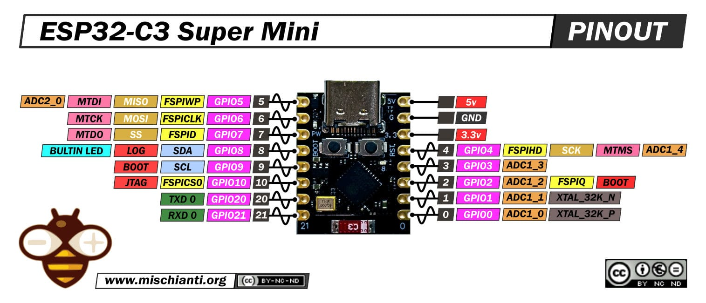

# 🔌 회로 구성

ESP32-C3 SuperMini 하나로 12V 부하 두 개(배기팬, LED 스트립)를 MOSFET 모듈로 제어합니다.

## 핀 배치
펌웨어 기준은 [Config.h](../firmware/AutoExhaust/Config.h)입니다.

| 기능 | GPIO | 동작 |
|---|---|---|
| MOSFET 1 → 배기팬 | **4** | LEDC PWM 25kHz, 8bit |
| MOSFET 2 → LED 스트립 | **5** | LEDC PWM 5kHz, 8bit |
| RGB LED R / G / B | **0 / 1 / 10** | LEDC PWM 5kHz. 공통 캐소드라서 255가 켜짐 |
| 12V 전압 측정 | **3** (ADC1_CH3) | 분압 1:6, `analogReadMilliVolts` 16회 평균 |
| 버튼 | **9** | `INPUT_PULLUP`, 눌리면 LOW. 보드의 BOOT 버튼과 같은 핀 |
| 내장 LED | **8** | LOW일 때 켜짐. WiFi 상태 표시 전용 |



**스트래핑 핀 주의**: GPIO8과 GPIO9는 전원을 넣는 순간의 레벨로 부팅 모드가 정해집니다. 전원을 넣을 때 버튼(GPIO9)을 누르고 있으면 다운로드 모드로 들어갑니다. 펌웨어는 부팅 시 이미 눌려 있던 버튼 입력을 무시합니다.

## 전원 경로
```
12V 어댑터 (1.5A)
  └─ 기계식 스위치 ─ [A] ─┬─ MOSFET 1 VIN ─ 배기팬 (120mm, 2핀, 약 1m)
                          ├─ MOSFET 2 VIN ─ LED 스트립 ×2 (약 20~30cm)
                          ├─ 13V 제너 ─ GND             (과전압 클램프)
                          ├─ 100kΩ ─┬─ 20kΩ ─ GND        (분압 1:6)
                          │         └─ GPIO3
                          └─ 강압 컨버터 ─ [B] 3.5~3.6V ─ 쇼트키 다이오드 ─ ESP32 3.3V 핀
```
- MOSFET 모듈은 로우사이드 스위칭이며 절연되어 있지 않습니다. 그래서 A 노드의 과도 전압이 ESP32 쪽으로 넘어오지 않게 하는 것이 설계의 핵심입니다.
- 강압 컨버터 출력은 **3.6V를 권장**합니다. 다이오드에서 0.3~0.4V가 떨어지므로, 3.5V로 두면 WiFi로 전송할 때 ESP32 전원이 최소 동작 전압(3.0V) 가까이까지 내려갑니다.
- 3.3V 핀 앞의 다이오드는 USB 전원과 강압 컨버터 출력이 서로 역류하지 않게 막습니다.

## 전류 예산
| 부하 | 전류 |
|---|---|
| LED 스트립 2개 (100%) | 약 1.33A (3개일 때 1.71A로 실측) |
| 배기팬 | 약 0.2A |
| ESP32 | 약 0.05A |

LED만 100%로 켜도 1.5A 어댑터의 정격에 가깝습니다. 그래서 펌웨어가 **조명을 70%(`MAX_LIGHT_DUTY`)로 제한**하고, 이 상한은 웹이나 API로도 넘을 수 없습니다. 이렇게 하면 합계는 약 1.18A로, 정격의 80% 안에 들어옵니다. 측정 결과는 [led_load_test_report.md](led_load_test_report.md)에 있습니다.

## 보호 부품 (권장)
| 위치 | 부품 | 이유 |
|---|---|---|
| A ~ GND (MOSFET 모듈 근처) | 470µF 16V + 100nF | 부하를 PWM으로 켜고 끌 때 생기는 펄스 전류를 이 자리에서 공급합니다 |
| 팬 모듈 출력 | 1N5819 (캐소드 → V+, 애노드 → 드레인) | 팬 코일의 역기전력을 흡수합니다(플라이백) |
| GPIO → MOSFET 게이트 | 직렬 1kΩ | 플라이백 다이오드가 고장 났을 때도 GPIO를 보호합니다 |
| ESP32 3.3V 핀 | 220µF + 100nF, 3.9V 1W 제너 | 전원 안정화와 과전압 클램프 |
| 강압 컨버터 입력 | 0.5A 퓨즈 | 제너가 과전압을 흡수하다 단락됐을 때 퓨즈가 끊어지게 합니다 |
| GPIO3 | 100nF | ADC 노이즈를 줄입니다 |

LED 스트립에는 커패시터를 달지 않습니다. 저항성 부하라 역기전력이 없고, 로우사이드 PWM에서 스트립 양단에 커패시터를 달면 매 주기마다 MOSFET에 돌입 전류가 흐르기 때문입니다.

## 알려진 특성
- **전압 측정값이 부하가 걸리면 약 0.15V 높게 나옵니다.** GND 배선에 부하 전류가 흐르면서 생기는 전압차 때문으로 추정합니다. 20kΩ 저항의 GND 쪽 끝을 ESP32 GND 핀에 바로 연결하면 줄어듭니다.
- **WiFi 수신 감도는 설치 위치에 크게 좌우됩니다.** 안테나 주변에 전선이나 금속이 없게 배치하세요. TX 출력은 11dBm을 씁니다. 관련 분석은 [esp32_c3_wifi_failure.md](../docs/notes/esp32_c3_wifi_failure.md)에 있습니다.

## 관련 문서
- [voltage_solution.md](bom/voltage_solution.md): DC-DC 컨버터 비교
- [powerfailure_solution.md](powerfailure_solution.md): MOSFET 모듈과 전원 보호
- [esp32_c3_spec.md](esp32_c3_spec.md): ESP32-C3 사양
